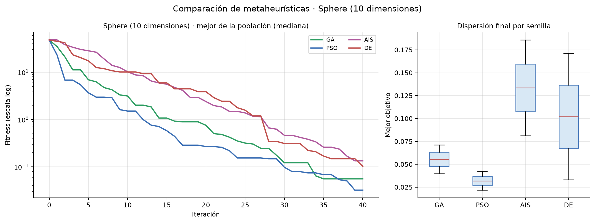

# Entorno Interactivo para Algoritmos Metaheurísticos

Aplicación de escritorio en Python para experimentar, comparar y visualizar
cinco metaheurísticas implementadas desde cero: **Algoritmo Genético (GA)**,
**Colonia de Hormigas (ACO)**, **Enjambre de Partículas (PSO)**, **Sistema
Inmune Artificial (CLONALG)** y **Evolución Diferencial (DE/rand/1/bin)**.

Incluye problemas continuos, binarios, el agente viajero y un caso real de
**rutas de reparto locales en Zapopan/Guadalajara**, con 12 nodos, distancias
Haversine corregidas por factor vial y capacidad de 180 kg por vehículo.



## Características

- Interfaz **CustomTkinter** con formularios dinámicos generados a partir de
  los esquemas de cada problema y algoritmo.
- Ejecución en **hilo secundario** con iniciar, pausar, reanudar, detener y
  reiniciar sin congelar la ventana.
- Historial de **snapshots** por iteración y control deslizante para revisar
  soluciones anteriores.
- Gráficas **Matplotlib** embebidas: convergencia, diversidad y visualización
  específica por problema.
- Semillas reproducibles y script de experimentos que genera las figuras
  `fig-3.png` … `fig-10.png`.
- Cero dependencias de metaheurísticas externas: no se usa `scipy.optimize`,
  `deap`, `pyswarms` ni equivalentes.

## Estructura

```text
proyecto_metaheuristicas/
├── main.py
├── requirements.txt
├── README.md
├── AGENTS.md
├── run_experiments.py
├── data/
│   └── rutas_reparto_zapopan.json
├── core/
│   ├── __init__.py
│   ├── base.py
│   └── engine.py
├── problems/
│   ├── __init__.py
│   ├── continuous.py
│   ├── binary.py
│   ├── discrete.py
│   └── delivery_zapopan.py
├── algorithms/
│   ├── __init__.py
│   ├── ga.py
│   ├── aco.py
│   ├── pso.py
│   ├── ais.py
│   └── de.py
└── ui/
    ├── __init__.py
    └── app.py
```

## Requisitos e instalación

- Python **3.10+** (probado con Python 3.13.3 en Windows).
- Tkinter incluido con Python.
- Dependencias: `customtkinter`, `matplotlib`, `numpy`.

```powershell
cd proyecto_metaheuristicas
python -m venv .venv
.\.venv\Scripts\Activate.ps1
python -m pip install --upgrade pip
pip install -r requirements.txt
```

En Linux/macOS la activación es:

```bash
source .venv/bin/activate
```

## Ejecución de la interfaz

```powershell
python main.py
```

Flujo recomendado:

1. Elige un **problema** en la barra lateral.
2. Elige un **algoritmo** compatible. ACO solo está disponible para TSP y
   rutas de reparto; en las demás familias la interfaz lo indica y desactiva
   el botón Iniciar.
3. Ajusta los parámetros del problema y del algoritmo. Cada campo tiene una
   descripción y puedes restaurar los valores por defecto.
4. Configura iteraciones, semilla, límite de tiempo y frecuencia de snapshot.
5. Pulsa **Iniciar**. Usa **Pausar**, **Detener** o **Reiniciar** según
   necesites; la corrida nunca bloquea la interfaz.

La pestaña **Convergencia** muestra el mejor objetivo, la media de la
población y la diversidad. **Solución** presenta la mejor solución y un
control de historial para inspeccionar iteraciones anteriores. **Registro**
conserva eventos, resumen y errores.

## Problemas incluidos

| Clave | Problema | Familia | Objetivo | Notas |
|---|---|---|---|---|
| `sphere` | Sphere | continua | minimizar | `f(x)=Σxᵢ²`, dimensión y límites configurables |
| `rastrigin` | Rastrigin | continua | minimizar | multimodal, `10n+Σ(xᵢ²−10cos(2πxᵢ))` |
| `onemax` | OneMax | binaria | maximizar | número de bits en 1 |
| `knapsack` | Mochila 0-1 | binaria | maximizar | penalización por exceso de capacidad |
| `tsp` | TSP | permutación | minimizar | ciudades generadas de forma reproducible |
| `delivery_zapopan` | Rutas de reparto Zapopan | permutación | minimizar | 12 nodos, Haversine × 1.25, `Q_max=180 kg` |

### Dataset de Zapopan

`data/rutas_reparto_zapopan.json` contiene **12 nodos**: una base CEDIS y 11
puntos de entrega reales de Zapopan/Guadalajara con coordenadas aproximadas
(latitud/longitud). Las demandas son sintéticas pero plausibles y suman
**194 kg**, por lo que la solución requiere al menos dos rutas con capacidad
de 180 kg.

La función objetivo suma la distancia de cada ruta (base → clientes → base),
calculada con Haversine y multiplicada por `road_factor = 1.25`, más un costo
fijo de 8 km equivalentes por ruta para evitar abrir vehículos innecesarios.
La permutación se divide en rutas factibles de forma voraz: cuando el
siguiente cliente excede `Q_max`, comienza una ruta nueva.

## Algoritmos y adaptaciones

| Algoritmo | Continua | Binaria | Permutación |
|---|---|---|---|
| GA | BLX-α / 1 punto + gaussiana | 1 punto + bit-flip | OX + intercambio |
| ACO | — | — | Ant System nativo |
| PSO | PSO clásico | BPSO con sigmoide | Random-Key |
| AIS | CLONALG gaussiano | CLONALG bit-flip | CLONALG con swaps |
| DE | DE/rand/1/bin | sigmoide sobre la prueba | Random-Key |

Todos los algoritmos usan selección por torneo o ruleta cuando aplica,
elitismo donde está disponible y comparaciones basadas en el sentido del
problema (minimizar o maximizar). El conteo de evaluaciones y los snapshots
se gestionan en `core/base.py`.

### Parámetros principales

- **GA**: tamaño de población, selección, tamaño de torneo, tipo de cruza,
  probabilidad de cruza, tasa de mutación, intensidad, alpha de BLX y élites.
- **ACO**: número de hormigas, `alpha`, `beta`, evaporación `rho`, `Q` y
  feromona inicial.
- **PSO**: tamaño del enjambre, inercia `w`, `c1`, `c2` y `v_max`.
- **AIS**: población, seleccionados, clones por anticuerpo, hipermutación,
  reemplazo y élites.
- **DE**: población, factor `F` y probabilidad de cruza `CR`.

## Experimentos y figuras

```powershell
# Verificación rápida (pocas semillas e iteraciones)
python run_experiments.py --quick

# Resultados completos del informe
python run_experiments.py
```

El script escribe en la raíz del proyecto:

| Archivo | Contenido |
|---|---|
| `fig-3.png` | Convergencia del GA en Sphere y Rastrigin |
| `fig-4.png` | Comparación GA/PSO/AIS/DE en Sphere |
| `fig-5.png` | Comparación en Rastrigin |
| `fig-6.png` | OneMax y Mochila 0-1 |
| `fig-7.png` | Mejor ruta TSP y convergencia de los cinco algoritmos |
| `fig-8.png` | Rutas de reparto Zapopan, convergencia y carga por ruta |
| `fig-9.png` | Robustez en TSP con 8 semillas |
| `fig-10.png` | Escalabilidad del TSP |
| `resultados_experimentos.csv` | Una fila por corrida |
| `resultados_experimentos.json` | Resumen reproducible y tiempos |

Todas las corridas usan semillas fijas (`2026+`, `3000+`, `4000+`, `5000+`).
El modo `--quick` conserva el mismo código y sirve para comprobar el entorno
sin esperar la ejecución completa. El backend es Agg: no se abren ventanas.

## Arquitectura

- `core/base.py`: contratos `Problem` y `MetaheuristicAlgorithm`, `ParamSpec`,
  `Snapshot`, operadores genéticos compartidos y plantilla de ejecución.
- `core/engine.py`: hilo secundario, cola de eventos, pausa/parada/reinicio y
  helper `run_sync` para experimentos.
- `problems/`: cada problema declara su familia, sentido, esquema de parámetros,
  validación, diversidad y descripción para la UI.
- `algorithms/`: implementaciones comentadas de los cinco algoritmos.
- `ui/app.py`: formularios dinámicos, métricas, pestañas, gráficas y control
  del motor. Tkinter solo se toca desde el hilo principal.

La UI nunca importa lógica de optimización específica: crea problemas y
algoritmos desde los registros de `problems/__init__.py` y
`algorithms/__init__.py`, y construye los formularios desde `ParamSpec`.

## Reproducibilidad y verificación

```powershell
# Matriz headless de todas las combinaciones válidas
python -c "from problems import PROBLEMS; from algorithms import ALGORITHMS; ..."

# Comprobar sintaxis
python -m compileall -q main.py core problems algorithms ui
```

Criterios comprobados durante el desarrollo:

- las 26 combinaciones problema × algoritmo compatibles ejecutan y devuelven
  soluciones válidas;
- la misma semilla produce los mismos resultados;
- pausar, reanudar, detener y reiniciar funcionan sin bloquear Tkinter;
- las visualizaciones se generan para las tres familias y el caso real;
- `run_experiments.py --quick` termina y produce las ocho figuras.

## Limitaciones

- ACO se implementa para permutaciones; en problemas continuos o binarios se
  desactiva en la interfaz porque el Ant System clásico requiere un grafo.
- Las coordenadas del dataset son aproximadas y las demandas son sintéticas;
  el objetivo es académico y reproducible, no logístico real.
- El problema de reparto usa una flota implícita: cada ruta equivale a un
  vehículo con capacidad `Q_max`.
- Este repositorio **no incluye licencia**; los derechos quedan reservados por
  defecto.

## Documentación para agentes

Consulta [`AGENTS.md`](AGENTS.md) para comandos, contratos, convenciones y la
lista de verificación antes de modificar el proyecto.
